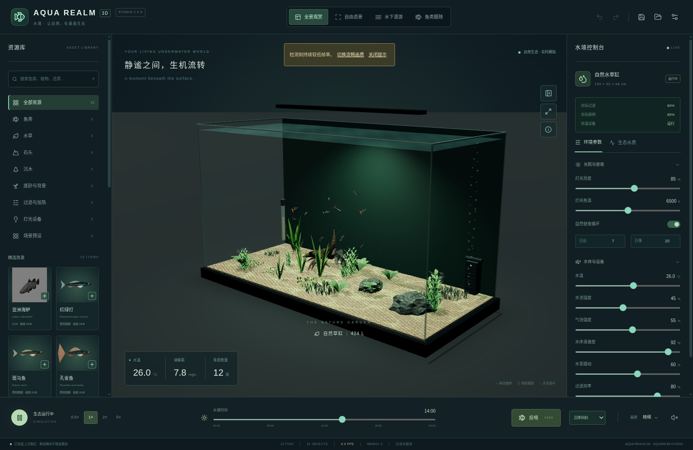

# AQUA REALM 3D 1.0 · Windows 养鱼模拟器

[下载完整运行包 ZIP](https://github.com/leq06093-a11y/3D-1028/archive/refs/heads/aqua-download-1.0.0.zip)

## 开始使用

1. 下载上面的 ZIP，等待下载完成（约 131 MiB）。
2. 右键压缩包，选择 **全部解压缩**。
3. 打开解压后的文件夹，双击 **START-AQUA.cmd**。
4. 等待校验、拼合与首次解包，点击 **开始养鱼**。

无需安装 Node.js 或 Blender，无需管理员权限。请保留两个 AQUA.part 文件和 manifest.json，不能在压缩包内直接运行。启动器只在本地校验、拼合并打开程序，不联网、不更改执行策略、不关闭系统防护。以后也可双击生成的 AQUA-REALM-3D-1.0.0-Windows.exe。

程序超过 GitHub 单文件限制，因此以两个经过 SHA-256 校验的文件存储；下载 ZIP 已包含全部文件，无需分别下载或自行输入命令。

## 已实现

五种鱼类、群游与摄食、自由造景、设备控制、水质近似模拟、四种镜头、画质选项、场景导入导出、自动存档和备份恢复。完整源码、四个原始 Blender 工程、素材许可与中文说明位于附带的 source.zip 内，源码目录为 aqua-realm。

## 验证与限制

64 项单元测试通过；打包 app.asar 在 Linux Electron 中离线加载、高清水体着色器、真实模型以及退出/恢复存档均已测试。Windows x64 产物已构建并校验，但 Windows 本机与 RTX 帧率尚未实测；未宣称照片级真实或 60 FPS。程序未签名，遇到系统安全提示时请先确认来源，不要关闭系统防护。生态模拟用于娱乐，不能代替真实养殖指导。

运行 EXE SHA-256：`835606de73a5192b65e8c83dc5c73256046af1261595047e6270d32dbd40981f`。

本分支仅保存交付文件；原地球项目 main 分支保留。源码版本：73c1082，标签 aqua-v1.0.0-ready（版本记录见源码包）。

